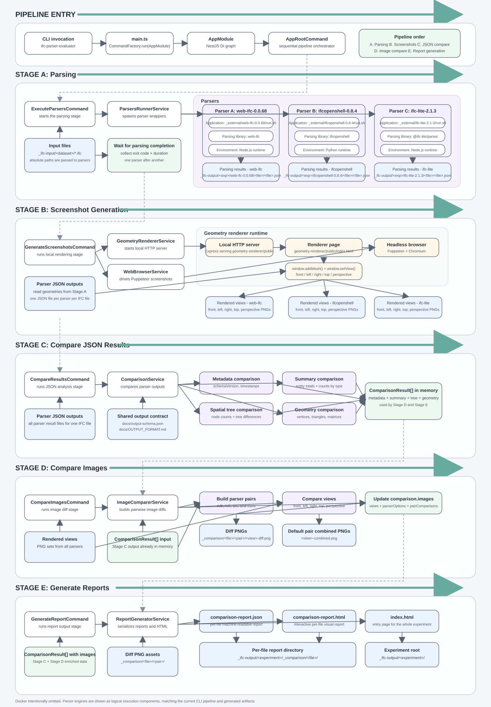

# System Diagram

This document shows the current stage-oriented architecture and data flow of the IFC parser evaluator. The diagram mirrors the real CLI pipeline with a finer granularity: commands, services, parser applications, parsing libraries, runtimes, storage artifacts, and generated reports.

## Layers

- Entry and orchestration: `main.ts`, `AppModule`, and `AppRootCommand`.
- Stage A: parser execution through `_external/*/run.sh`, parser libraries, and their runtimes.
- Stage B: local geometry renderer, headless browser, and per-parser PNG generation.
- Stage C and D: JSON comparison, image comparison, pairwise diff generation, and `ComparisonResult[]` enrichment.
- Stage E: per-file reports and experiment index output under `_ifc-output/<experiment>/...`.

Docker intentionally omitted; parsers are shown as logical execution components.

## Notes

- The stage order matches `AppRootCommand`: execute parsers, generate screenshots, compare JSON results, compare images, generate report.
- Parser outputs follow the shared contract defined in [output-schema.json](./output-schema.json) and [OUTPUT_FORMAT.md](./OUTPUT_FORMAT.md).
- The SVG is the embeddable documentation artifact, while [system-diagram.puml](./system-diagram.puml) remains the editable source.
